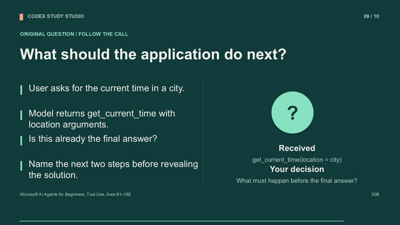
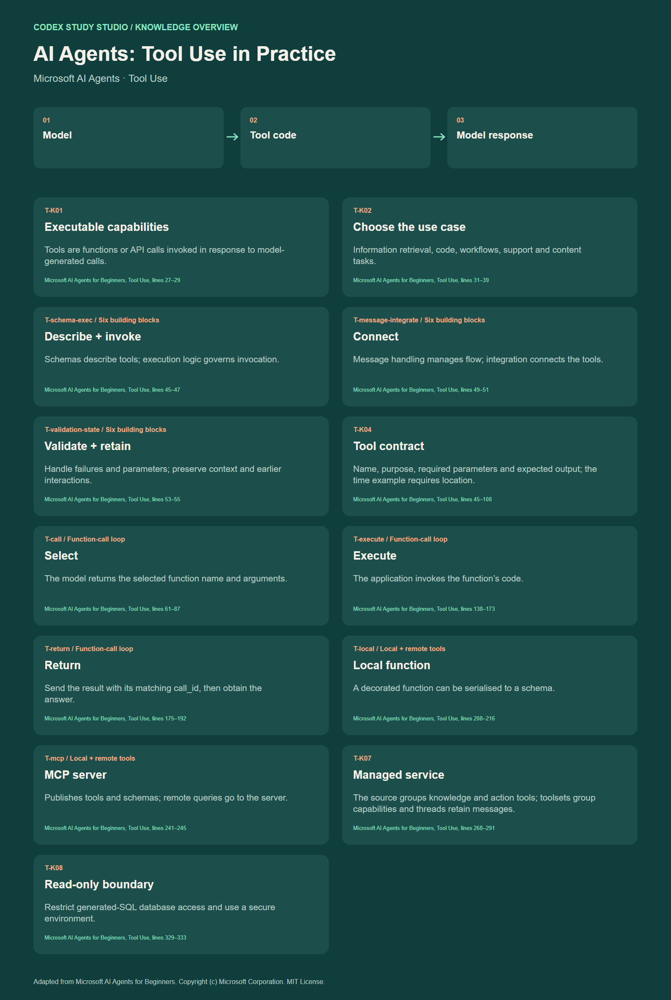

# Codex Study Studio

[English](README.md) · [简体中文](README.zh-CN.md)

[](LICENSING.md)
[](https://github.com/Moonaria123/Codex-Study-Studio/tags)
[](https://github.com/Moonaria123/Codex-Study-Studio/actions/workflows/validate.yml)
[](verification/README.md)
[](#install--four-ways)
[](https://moonaria123.github.io/Codex-Study-Studio/demo/StudyHub.html)

**Turn your textbook into a course you can study, practise and teach.**

Codex Study Studio is a source-available skill for **Codex** that turns your chosen book or course material into **structured notes, editable slides, narrated lessons and an interactive study hub**. It is free for noncommercial use under its [licence](LICENSING.md). Give it a source, choose the chapters and resources you need, and build a learning workspace that grows with your reading.

> When I'm learning something difficult, I want a teacher who is also a study partner: someone to help me decide where to begin, remember what we've covered, and, when I get stuck, try a different example, draw a diagram or walk me through the reasoning step by step.
>
> That's why I built Study Studio: to turn agents such as Codex, with their contextual memory and processing power, into **your own teacher and study partner**—so you have a path to follow and support along the way.

Use it to understand a difficult chapter, practise what you have learnt, or prepare teaching materials from the same source. It comes with English and Chinese skill instructions and works across subjects.

**[Try the study hub](https://moonaria123.github.io/Codex-Study-Studio/demo/StudyHub.html)** · **[Install the skill](#install--four-ways)** · [Watch a full sample lesson](https://www.youtube.com/watch?v=aLF_IylZ3y8)

<p align="center"><a href="https://moonaria123.github.io/Codex-Study-Studio/"></a></p>

## Contents

- [See it in action](#see-it-in-action)
- [Why use Study Studio?](#why-use-study-studio)
- [Who is it for?](#who-is-it-for)
- [How it works](#how-it-works)
- [What you can make](#what-you-can-make)
- [Your study hub, in use](#your-study-hub-in-use)
- [Install — four ways](#install--four-ways)
- [Start your first studio](#start-your-first-studio)
- [Example library](#example-library)
- [Requirements and learning records](#requirements-and-learning-records)
- [Common questions](#common-questions)
- [Repository layout](#repository-layout) · [Licence and attribution](#licence-and-attribution)
- [Roadmap](#roadmap)

## See it in action

Explore a complete set of resources for **AI agent tool use**: read the chapter review, follow the narrated lesson, inspect the editable slides, then test yourself in the study hub. Everything is built around the same selected lesson from Microsoft's **AI Agents for Beginners** course.

[](https://www.youtube.com/watch?v=aLF_IylZ3y8)

**[Open the interactive demo](https://moonaria123.github.io/Codex-Study-Studio/demo/StudyHub.html)** · **[Watch the full lesson](https://www.youtube.com/watch?v=aLF_IylZ3y8)** · [Browse all sample files](#example-library)

Try the demo in your browser without installing the skill. The sample uses an attributed, MIT-licensed lesson; its [source and edition](examples/ai-agents-tool-use/SOURCE.md) are recorded. The [15-second MP4 preview](docs/demo/Lecture_Preview_15s.mp4) is also available directly.

## Why use Study Studio?

- **Give your reading a direction.** A course outline and chapter maps connect the material, so you can see what to learn next and where each idea fits.
- **Turn understanding into practice.** Move from explanations to recall cards, quizzes and a mistake notebook, with answers you can trace back to the source.
- **Build several resources from one reading.** Chapter reviews provide a shared foundation for slides, narration, visuals and questions, helping keep the teaching materials consistent.
- **Keep a workspace you can return to.** Request only what you need, add chapters over time, edit your flashcards and carry your learning records with a complete backup.

## Who is it for?

| If you are… | Use it to… |
|---|---|
| **A student or independent learner** | Turn a dense textbook into a reading route, chapter explanations and material for active revision. |
| **Preparing for a course or professional exam** | Connect the book to verified official learning requirements, then practise the relevant concepts. |
| **A teacher, tutor or trainer** | Prepare editable slides, a teaching script, a narrated lesson and exercises from your chosen source. |
| **A developer learning a new subject** | Work through technical course material with concept maps, worked examples and checks of understanding. |

The AI agent lesson is an example of the workflow. You choose the subject, source edition, learning goals and output language for your own studio.

## How it works

**Your source → a learning route → chapter understanding → selected resources → ongoing study**

| Step | What happens | What it gives you |
|---|---|---|
| **1. Set the scope** | Give Codex the source and edition, a destination folder, and the chapters and modules you want. | A defined project, from one chapter's flashcards to a full set of learning materials. |
| **2. Map the material** | Codex reads and indexes the book, identifies chapter boundaries and connects the learning sequence. Where applicable, it maps verified official course or exam requirements. | An outline, source index and priorities for your reading. |
| **3. Read the chapter closely** | Codex follows the selected chapter's explanations, diagrams and examples, recording key ideas, distinctions and source locations. | A chapter review that becomes the common foundation for the requested modules. |
| **4. Make the modules you choose** | The reviewed content is used to produce notes, slides, scripts, videos, knowledge overviews, exercises or the study hub, with checks appropriate to each output. | Resources for reading, watching, teaching and practising. |
| **5. Study and extend** | Open the hub, practise and save your progress. Ask Codex to add another chapter or revise an existing resource while preserving course identifiers. | One growing course workspace, with learning records you can back up and restore. |

Start at the stage you need: an existing, verified chapter review can be reused. General reading can skip official syllabus mapping. Media production uses the rendering, voice and encoding tools available in your environment; see [requirements](#requirements-and-learning-records).

## What you can make

Choose individual modules or request the full set. Each serves a different part of learning or teaching.

| Module | How it helps you | What you receive |
|---|---|---|
| **Course outline** | See the big picture, prerequisites and a sensible reading order before diving into details. | `Outline.md`, a chapter index and source locations. |
| **Learning requirements** | Focus on the outcomes relevant to your course or exam. | `Syllabus.md` mapped to verified official requirements, when applicable. |
| **Chapter review** | Work through definitions, distinctions, formulas and examples with references back to the text. | A structured chapter review in Markdown. |
| **Editable teaching slides** | Explain a chapter to others or revise it visually; adapt the deck for your own session. | PowerPoint, speaker notes and a matching teaching script. |
| **Narrated lesson** | Follow the explanation as a video, with worked steps and pauses to think before answers. | A teaching video, narration script and subtitles. |
| **Knowledge overview** | See how the ideas connect and return to the chapter's structure during revision. | A visual overview in SVG and PNG. |
| **Practice and answers** | Apply the source concepts and learn from the reasoning behind each answer. | A printable practice PDF with explanations and source references. |
| **Interactive Study Hub** | Switch between maps, recall and practice in one place, and keep a record of your learning. | One `StudyHub.html` with mind maps, flashcards, quizzes and learning records. |

The workflow keeps subject knowledge tied to your chosen source. Official materials guide learning requirements; original questions and examples are labelled and derived from the source concepts. [Inspect the sample review](examples/ai-agents-tool-use/Chapter%2004%20-%20Tool%20Use/CharpterReview.md) to see that connection.

## Your study hub, in use

The finished hub opens in a browser, online or from a downloaded HTML file. It brings the learning activities together:

1. **Explore and understand.** Choose a chapter and navigate its mind map. **Double-click any node to read its detailed explanation and source index**: book title, edition, section, printed pages and PDF file pages where applicable. Open the linked source when you want to read further. Touchscreen double-tap and keyboard Shift+Enter also work. The hub remembers your map view and exports PNG or SVG.
2. **Check your recall.** Reveal flashcard answers, rate what you know, filter the library and edit cards to suit your revision.
3. **Apply what you learnt.** Take four-option quizzes in practice mode, or use timed exam mode when configured. Save an unfinished attempt and return to it later.
4. **Learn from mistakes.** Review submitted answers and explanations, compare attempt histories and print a mistake notebook for focused revision.
5. **Continue next time.** Progress stays in the current browser. Export a complete JSON backup to restore it when you move to another browser or device.

**[Try this learning loop in the demo →](https://moonaria123.github.io/Codex-Study-Studio/demo/StudyHub.html)**

## Install — four ways

**Recommended: ask Codex to install it using method 1.** Use a ZIP for manual installation, clone the repository to customise it, or call the bundled installer from your terminal.

Choose `study-studio-en` for English instructions or `study-studio-zh` for Chinese instructions. Both packages contain the same runtime and can coexist. The bundled study-hub interface is English; requesting another interface language requires a separate localisation pass.


### 1. Ask Codex to install it

Paste this into Codex, which includes the built-in skill installer:

```text
Use $skill-installer to install the skill from
https://github.com/Moonaria123/Codex-Study-Studio/tree/main/skills/study-studio-en
```

For Chinese, replace the last path with `skills/study-studio-zh`.

<details>
<summary>2. Download a ready-to-use ZIP</summary>

Download [the English skill ZIP](https://moonaria123.github.io/Codex-Study-Studio/downloads/study-studio-en.zip) or [the Chinese skill ZIP](https://moonaria123.github.io/Codex-Study-Studio/downloads/study-studio-zh.zip). Extract the top-level skill folder into your skills directory:

| Platform | Default directory |
|---|---|
| Windows | `%USERPROFILE%\.codex\skills\` |
| macOS / Linux | `~/.codex/skills/` |
| Custom Codex home | `$CODEX_HOME/skills/` |

The result should be `.../skills/study-studio-en/SKILL.md` (or `study-studio-zh/SKILL.md`). Keep an existing installation backed up; do not merge folders blindly.

</details>

<details>
<summary>3. Clone and use the local installer</summary>

```sh
git clone https://github.com/Moonaria123/Codex-Study-Studio.git
cd Codex-Study-Studio
python scripts/install.py --language en
```

Use `--language zh` or `--language both` as needed. On systems with `python3`, substitute that command. The installer needs Python 3.10+ and **refuses to overwrite an existing skill**. Use `--dest /your/skills/directory` for an explicit destination.

</details>

<details>
<summary>4. Use Codex's bundled installer directly</summary>

macOS / Linux:

```sh
python3 "${CODEX_HOME:-$HOME/.codex}/skills/.system/skill-installer/scripts/install-skill-from-github.py" \
  --repo Moonaria123/Codex-Study-Studio --path skills/study-studio-en
```

Windows PowerShell:

```powershell
$codexRoot = if ($env:CODEX_HOME) { $env:CODEX_HOME } else { Join-Path $env:USERPROFILE '.codex' }
python (Join-Path $codexRoot 'skills/.system/skill-installer/scripts/install-skill-from-github.py') `
  --repo Moonaria123/Codex-Study-Studio --path skills/study-studio-en
```

This method requires the bundled installer to be present. After installation, invoke the skill on your next Codex turn; if it is not discovered, start a new chat.

</details>

## Start your first studio

After installing, tell Codex **which source to use, where to save the work, and what you want to make**. Replace the example paths with your own. A focused first run is easy to review:

```text
Use $study-studio-en with the textbook at /path/to/book.pdf.
Save the course under /path/to/learning.
Closely read Chapter 1 and create its chapter review, a mind map
and flashcards in one StudyHub.html. Use English for the learning content.
```

<details>
<summary>Ready for a complete chapter? Copy this request</summary>

```text
Use $study-studio-en with the source textbook at /path/to/book.pdf.
Create the course under /path/to/learning.
Build the outline and map official learning requirements where applicable.
Closely read Chapter 1, then create its review, editable slides, teaching
script, narrated video with subtitles, knowledge overview, practice PDF
with answers, and a study hub with maps, flashcards and quizzes.
Use English for the learning content and report the outputs and checks.
```

</details>

To keep going, ask Codex to add Chapter 2 to the same course and hub, preserving existing learning records. You can also request just a slide deck, a practice set or another individual module.

## Example library

| Explore | Open |
|---|---|
| Complete offline sample | [Download the sample ZIP](https://moonaria123.github.io/Codex-Study-Studio/downloads/ai-agents-tool-use-example.zip) |
| Interactive mind map, flashcards and quiz | [Live StudyHub](https://moonaria123.github.io/Codex-Study-Studio/demo/StudyHub.html) |
| Reading plan and official course outcomes | [Outline](examples/ai-agents-tool-use/Outline.md) · [Syllabus](examples/ai-agents-tool-use/Syllabus.md) |
| Source-grounded teaching foundation | [Chapter review](examples/ai-agents-tool-use/Chapter%2004%20-%20Tool%20Use/CharpterReview.md) · [Source excerpt](examples/ai-agents-tool-use/Chapter%2004%20-%20Tool%20Use/Chapter_Source.md) |
| Editable teaching slides | [PowerPoint](examples/ai-agents-tool-use/Chapter%2004%20-%20Tool%20Use/Lecture.pptx) · [PDF](examples/ai-agents-tool-use/Chapter%2004%20-%20Tool%20Use/Lecture.pdf) |
| Narrated lesson | [Full MP4](examples/ai-agents-tool-use/Chapter%2004%20-%20Tool%20Use/Lecture.mp4) · [Script](examples/ai-agents-tool-use/Chapter%2004%20-%20Tool%20Use/LectureScript.md) · [Subtitles](examples/ai-agents-tool-use/Chapter%2004%20-%20Tool%20Use/Lecture.srt) |
| Visual knowledge overview | [PNG](examples/ai-agents-tool-use/Chapter%2004%20-%20Tool%20Use/Knowledge_Overview.png) · [SVG](examples/ai-agents-tool-use/Chapter%2004%20-%20Tool%20Use/Knowledge_Overview.svg) |
| Original practice and explanations | [Practice PDF](examples/ai-agents-tool-use/Chapter%2004%20-%20Tool%20Use/Practice_and_Answers.pdf) |
| Source edition and production record | [Studio.json](examples/ai-agents-tool-use/Studio.json) · [Verification](verification/README.md) |

[](examples/ai-agents-tool-use/Chapter%2004%20-%20Tool%20Use/Knowledge_Overview.svg)

## Requirements and learning records

| What you want to do | What you need |
|---|---|
| **Try the finished demo** | A modern browser. The hub needs no account or backend. |
| **Create your own studio** | Codex with skill support and a readable source you have permission to use. |
| **Build a study hub** | Python 3.10+ with IANA time-zone data; the builder uses the standard library. PDF splitting also needs `pypdf` or an available equivalent. |
| **Produce slides, PDFs or video** | Suitable rendering, speech synthesis and video encoding tools. No paid provider is mandatory; available tools determine the production route. |

Learning records are local to the browser and origin. The live website and a downloaded copy have separate storage. Use **Data & backup → complete JSON** to move records into the same course on another browser or device. A readable HTML history report is also available; use JSON for complete recovery.

## Common questions

**Is this an app I install, or a Codex skill?**

You install a skill that guides Codex through the production workflow. The generated files are yours to use independently: read Markdown, edit the PowerPoint, play the video or open the study hub in a browser.

**Does everything run offline?**

The finished study hub works offline and stores progress locally. Creating resources uses Codex and your chosen production tools, which may use online services. Local hub storage does not determine how those tools process your source.

**Can I use another subject or language?**

Yes. The skill is not tied to a course or exam. English and Chinese packages provide the same workflow; choose the language of the learning content in your request. The bundled hub interface is English. Another interface language requires a separate localisation and verification pass.

**What does the sample demonstrate?**

A complete resource set for one selected Tool Use lesson, alongside the course index and provider learning goals. Explore the [source record](examples/ai-agents-tool-use/SOURCE.md) and [verification results](verification/README.md) for its scope and production details.

## Repository layout

<details>
<summary>Explore the skills, templates, sample source and checks</summary>

```text
skills/study-studio-en/  English skill, templates and runtime
skills/study-studio-zh/  Chinese skill, templates and runtime
examples/ai-agents-tool-use/    Source-grounded, reproducible demonstration
docs/                  GitHub Pages showcase and live study hub
scripts/               Local installer and example production tools
verification/          Checks, scope and production limitations
```

</details>

## Licence and attribution

This repository's **v1.0.0** is licensed under **[PolyForm Noncommercial 1.0.0](LICENSE)**. Commercial use outside its permissions requires **prior written authorisation from Moonaria123**; see [licensing and commercial enquiries](LICENSING.md). When redistributing Study Studio-owned material covered by the project's PolyForm licence, modified or unmodified, you must include the PolyForm terms or URL and preserve every supplied `Required Notice:` line, including the original-author notice in [NOTICE.md](NOTICE.md). A source link alone does not replace that notice. Separately identified third-party material remains governed by its own licence and notice requirements. The project is source-available with noncommercial restrictions. Copies previously obtained from the former repository under MIT retain their original rights; this new v1.0.0 starts a separate release sequence. Microsoft's source material retains its MIT copyright and permission notice. No proprietary textbook is redistributed.

Built by [Moonaria123](https://github.com/Moonaria123). Improvements and reproducible bug reports are welcome through [Issues](https://github.com/Moonaria123/Codex-Study-Studio/issues).

## Roadmap

The current version focuses on turning source material into resources you can study, practise with and teach from. The next steps are to help you decide **what to learn next** and bring the whole learning experience into **one Study Hub application**. These are planned directions for future versions.

### v2 — Learning planning

The aim is to give your personal teacher a clearer understanding of your goals, starting point and available time, so it can help you build a realistic path through the material.

- **Plan around your situation.** Use your learning goals, existing knowledge, target date and available study time to shape the sequence and pace.
- **Turn the route into manageable sessions.** Break chapters and prerequisites into stages, with reading, explanations, practice and revision arranged into daily or weekly tasks.
- **Adapt as you learn.** Use progress, quiz results and recurring mistakes to suggest changes to the plan, with room to slow down, revisit a topic or move ahead.

The experience we want: open your plan and know what to work on today, why it matters and how it connects to your goal.

### v3 — A unified Study Hub application

The vision is a single home for your courses, learning resources, plans and records, where the teacher's guidance and your day-to-day study sit together.

- **Keep your courses together.** Organise multiple books and courses in one library, with their notes, slides, videos and practice materials easy to find.
- **Move naturally between learning activities.** Read an explanation, watch a lesson, explore a map, recall with flashcards and test yourself within a consistent interface.
- **Connect planning with practice.** Bring v2's learning plans together with progress and mistake records, so you can return to a course and see where to continue.

The longer-term goal is a personal learning space that helps you find your way through difficult material, remembers the work you have done and supports the next step—bringing Study Studio closer to the teacher and study partner it was created to be.
