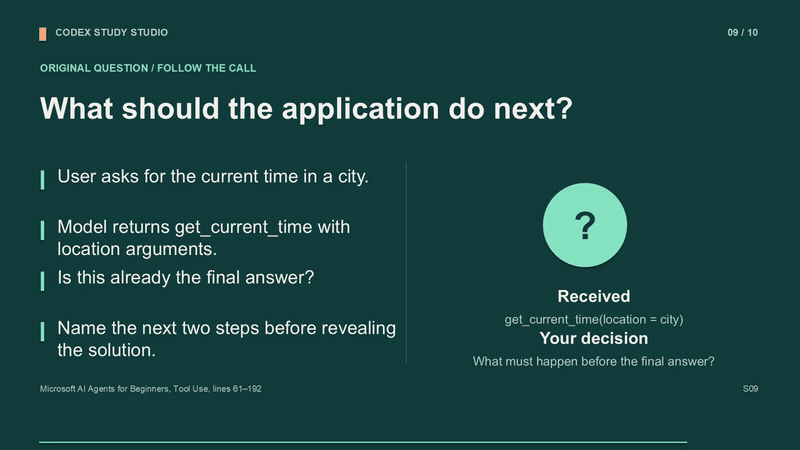
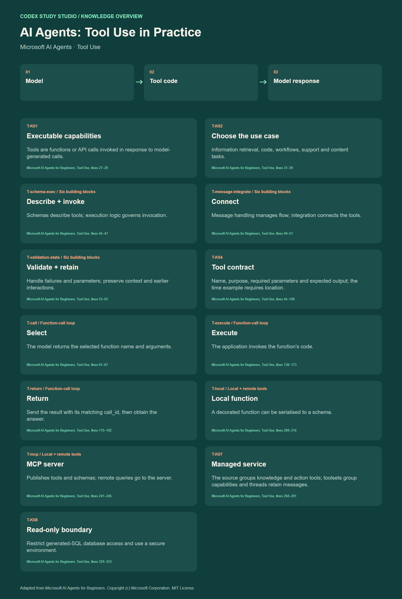

# Codex Study Studio

[English](README.md) · [简体中文](README.zh-CN.md)

[](LICENSING.md)
[](https://github.com/Moonaria123/Codex-Study-Studio/tags)
[](https://github.com/Moonaria123/Codex-Study-Studio/actions/workflows/validate.yml)
[](verification/README.md)
[](#installation)
[](https://moonaria123.github.io/Codex-Study-Studio/demo/StudyHub.html)

**把一本教材，变成可以学、可以练、可以教的完整课程。**

Codex Study Studio 是一套源码公开、按[许可](LICENSING.md)供非商业用途免费使用的 **Codex 技能**，让 Codex 围绕你指定的书籍或课程资料，制作**结构化笔记、可编辑课件、配音教学视频和交互式学习网页**。提供教材，选好章节和所需资源，就能逐步建立自己的学习工作室。

> 学习难懂的知识时，我希望有一位老师，也有一位学习伙伴：帮我规划从哪里开始，记得我们学到哪里，在我卡住时换个例子、画张图，或把推理一步步讲清楚。
>
> 这就是我制作 Study Studio 的初心：借助 Codex 等智能体的上下文记忆与强大处理能力，把它们变成**专属自己的老师和学习伙伴**，让学习有方向，也有人陪着走下去。

你可以用它读懂难学的章节、练习刚学过的知识，也可以基于同一份资料备课。技能提供中英文两套指令，适用于不同学科。

**[直接体验学习网页](https://moonaria123.github.io/Codex-Study-Studio/demo/StudyHub.html)** · **[安装技能](#installation)** · [观看完整样例课程](https://www.youtube.com/watch?v=aLF_IylZ3y8)

<p align="center"><a href="https://moonaria123.github.io/Codex-Study-Studio/zh.html"></a></p>

## 目录

- [看看实际效果](#showcase)
- [为什么使用 Study Studio](#why)
- [适合哪些用户](#audience)
- [从教材到学习：完整工作流程](#workflow)
- [各个模块能帮你做什么](#resources)
- [在学习网页中，你会怎样学习](#study-experience)
- [安装：四种方式](#installation)
- [开始你的第一个学习工作室](#getting-started)
- [完整样例库](#examples)
- [运行要求与学习记录](#requirements)
- [常见问题](#faq)
- [仓库结构](#layout) · [许可与署名](#licence)
- [后续迭代路线](#roadmap)

<a id="showcase"></a>

## 看看实际效果

以 **AI Agent 工具调用**为例：先读章节精读笔记，跟随视频理解讲解，打开可编辑课件，再进入学习网页检验掌握情况。这套资源都围绕 Microsoft **AI Agents for Beginners** 开放课程中的同一个指定课节制作。

[](https://www.youtube.com/watch?v=aLF_IylZ3y8)

**[打开交互式样例](https://moonaria123.github.io/Codex-Study-Studio/demo/StudyHub.html)** · **[观看完整视频](https://www.youtube.com/watch?v=aLF_IylZ3y8)** · [浏览全部样例文件](#examples)

无需安装技能，就能在浏览器里体验成品。样例采用 MIT 许可课节，保留署名并记录了[来源与版本](examples/ai-agents-tool-use/SOURCE.md)，也可直接下载 [15 秒 MP4 预览](docs/demo/Lecture_Preview_15s.mp4)。

<a id="why"></a>

## 为什么使用 Study Studio

- **让阅读有路线。** 全书纲要和章节知识图串起教材结构，帮助你判断下一步学什么、当前概念处在什么位置。
- **把理解变成练习。** 从讲解进入闪卡回忆、测验和错题复习，并通过来源定位回到原文查证答案。
- **一次精读，形成多种资源。** 章节评述为课件、讲稿、知识图和练习提供共同基础，帮助不同形式的教学材料保持一致。
- **让学习可以持续积累。** 按需制作模块，逐章扩展课程，编辑自己的闪卡，并通过完整备份保留学习记录。

<a id="audience"></a>

## 适合哪些用户

| 如果你是…… | 可以用它…… |
|---|---|
| **学生或自主学习者** | 将厚重教材转成阅读路线、章节讲解和主动复习材料。 |
| **课程或专业考试的备考者** | 把原书与核实过的官方学习要求对应起来，再练习相关知识。 |
| **教师、辅导老师或培训讲师** | 围绕指定资料制作可编辑课件、讲稿、配音课程和练习。 |
| **学习新领域的开发者** | 借助概念图、例子和理解检查，读懂技术课程材料。 |

AI Agent 课程只是工作流程的一个示例。你的工作室由你选择主题、资料版本、学习目标和输出语言。

<a id="workflow"></a>

## 从教材到学习：完整工作流程

**提供教材 → 梳理学习路线 → 精读章节 → 制作所需模块 → 学习与持续扩展**

| 阶段 | 会做什么 | 给你带来什么 |
|---|---|---|
| **1. 确定范围** | 向 Codex 提供资料及版本、保存位置、目标章节和需要的模块。 | 明确本次成果：可以只做一章闪卡，也可以制作整套学习资源。 |
| **2. 梳理教材** | Codex 阅读并索引全书，核对章节边界，串联学习顺序；适用时映射已核实的官方课程或考试要求。 | 全书纲要、来源索引，以及安排阅读先后的依据。 |
| **3. 精读章节** | 沿着指定章节的正文、图表和例子，梳理概念、辨析、推导与来源位置。 | 一份章节评述，作为后续模块共同的内容基础。 |
| **4. 制作模块** | 基于精读结果，按需制作笔记、课件、讲稿、视频、知识概览、练习和学习网页，并执行相应检查。 | 可用于阅读、观看、教学和练习的实际资源。 |
| **5. 学习与扩展** | 打开网页学习、练习并保存进度；继续请 Codex 添加章节或修订资源，同时保留课程标识。 | 持续扩展的课程空间，以及可备份、可恢复的学习记录。 |

可以从需要的阶段开始，复用已有且核实过的章节评述；普通阅读可以跳过官方考纲映射。媒体制作会使用当前环境中可用的渲染、语音和编码工具，详见[运行要求](#requirements)。

<a id="resources"></a>

## 各个模块能帮你做什么

可以单独选择模块，也可以要求制作完整的一套。每个模块服务于不同的学习或教学环节。

| 模块 | 帮你解决什么问题 | 交付什么 |
|---|---|---|
| **全书纲要** | 先看清全貌、前置知识和阅读顺序，再深入章节细节。 | `Outline.md`、章节索引和来源定位。 |
| **学习要求** | 明确课程或考试希望你掌握什么，将精力放在相关目标上。 | 适用时制作 `Syllabus.md`，对应核实过的官方要求。 |
| **章节精读与评述** | 理清定义、概念差异、公式和例子，并能回到原文。 | 结构化 Markdown 章节评述。 |
| **可编辑教学课件** | 向别人讲清一章内容，或用课件复习；还能按自己的授课需要修改。 | PowerPoint、演讲备注和配套讲稿。 |
| **配音教学视频** | 跟随讲解理解知识与解题步骤，在答案揭晓前停下来思考。 | 教学视频、配音讲稿和字幕。 |
| **知识概览图** | 看见知识之间的联系，复习时快速回到章节结构。 | SVG 和 PNG 格式的可视化概览。 |
| **练习与答案** | 用题目应用原书概念，从答案解析中理解推理过程。 | 可打印练习 PDF，附解析和来源定位。 |
| **交互式 Study Hub** | 在同一个入口切换导图、回忆和练习，并保留学习过程。 | 单个 `StudyHub.html`，整合思维导图、闪卡、测验与学习记录。 |

工作流程以你指定的原书为知识依据。官方资料用于学习要求映射；原创问题与例子围绕原书概念设计并明确标注。可以打开[样例章节评述](examples/ai-agents-tool-use/Chapter%2004%20-%20Tool%20Use/CharpterReview.md)，查看这些资源如何连接到来源。

<a id="study-experience"></a>

## 在学习网页中，你会怎样学习

成品学习网页可以在线打开，也可以下载为一个 HTML 文件后在浏览器中使用。一次学习可以这样展开：

1. **从框架深入知识。** 选择章节并浏览思维导图，**双击任意节点即可查看详细释义与来源索引**：书名、版本、小节，以及适用的印刷页码和 PDF 文件页序；需要进一步阅读时，可打开关联原文。也支持触屏双击和键盘 Shift+Enter。网页会记住导图视图，并支持导出 PNG 或 SVG。
2. **再检验记忆。** 翻看闪卡答案，标记掌握情况，按需筛选卡片，也可以修改卡片内容。
3. **用练习巩固。** 做四选一测验，或在配置了时限的课程中使用计时考试模式。未完成的练习可以保存，下次继续。
4. **针对错题复习。** 查看已提交答案和解析，比较历次练习记录，并打印错题本，集中复习薄弱点。
5. **保留这次进度。** 记录保存在当前浏览器；更换浏览器或设备时，可导出完整 JSON 备份并恢复。

**[现在就体验这条学习路径 →](https://moonaria123.github.io/Codex-Study-Studio/demo/StudyHub.html)**

<a id="installation"></a>

## 安装：四种方式

**推荐使用方式 1，让 Codex 帮你安装。** 手动安装可选 ZIP；需要修改技能可克隆仓库；习惯终端操作可直接调用内置安装器。

选择 `study-studio-en` 获取英文指令，或选择 `study-studio-zh` 获取中文指令。两个技能包包含相同的运行时代码，可以同时安装。附带学习网页的界面为英文；需要其他界面语言时，须另做本地化。


### 1. 请 Codex 帮你安装

将下面的请求粘贴到带有内置技能安装器的 Codex 中：

```text
使用 $skill-installer 安装以下技能：
https://github.com/Moonaria123/Codex-Study-Studio/tree/main/skills/study-studio-zh
```

如需英文版，将末尾路径换成 `skills/study-studio-en`。

<details>
<summary>2. 下载开箱即用的 ZIP</summary>

下载 [中文技能 ZIP](https://moonaria123.github.io/Codex-Study-Studio/downloads/study-studio-zh.zip) 或 [英文技能 ZIP](https://moonaria123.github.io/Codex-Study-Studio/downloads/study-studio-en.zip)，将其中最外层的技能文件夹解压到技能目录：

| 平台 | 默认目录 |
|---|---|
| Windows | `%USERPROFILE%\.codex\skills\` |
| macOS / Linux | `~/.codex/skills/` |
| 自定义 Codex 主目录 | `$CODEX_HOME/skills/` |

最终路径应为 `.../skills/study-studio-zh/SKILL.md`，或 `study-studio-en/SKILL.md`。已有安装请先备份，不要直接混合两个版本的文件夹。

</details>

<details>
<summary>3. 克隆仓库，使用本地安装器</summary>

```sh
git clone https://github.com/Moonaria123/Codex-Study-Studio.git
cd Codex-Study-Studio
python scripts/install.py --language zh
```

按需改为 `--language en` 或 `--language both`。系统使用 `python3` 时，替换相应命令。安装器需要 Python 3.10+，并且**拒绝覆盖已有技能**。使用 `--dest /your/skills/directory` 可指定目标技能目录。

</details>

<details>
<summary>4. 直接运行 Codex 内置安装器</summary>

macOS / Linux：

```sh
python3 "${CODEX_HOME:-$HOME/.codex}/skills/.system/skill-installer/scripts/install-skill-from-github.py" \
  --repo Moonaria123/Codex-Study-Studio --path skills/study-studio-zh
```

Windows PowerShell：

```powershell
$codexRoot = if ($env:CODEX_HOME) { $env:CODEX_HOME } else { Join-Path $env:USERPROFILE '.codex' }
python (Join-Path $codexRoot 'skills/.system/skill-installer/scripts/install-skill-from-github.py') `
  --repo Moonaria123/Codex-Study-Studio --path skills/study-studio-zh
```

此方法要求内置安装器已存在。安装后可在下一轮 Codex 对话中调用技能；若未被发现，开启新的聊天。

</details>

<a id="getting-started"></a>

## 开始你的第一个学习工作室

安装后，告诉 Codex **使用哪份资料、保存在哪里、需要哪些成果**，将示例路径替换成你自己的路径。第一次可以从便于检查的一小部分开始：

```text
使用 $study-studio-zh，读取 /path/to/book.pdf 中的教材。
将课程保存到 /path/to/learning 下。
精读第一章，制作章节评述，并在一个 StudyHub.html 中
提供该章的思维导图和闪卡。学习内容使用中文。
```

<details>
<summary>需要一章的完整资源？复制这段请求</summary>

```text
使用 $study-studio-zh，读取 /path/to/book.pdf 中的教材。
将课程创建在 /path/to/learning 下。
建立全书纲要，适用时映射官方学习要求。
精读第一章，制作章节评述、可编辑课件、讲稿、带字幕的配音视频、
知识概览图、附答案的练习 PDF，以及包含导图、闪卡和测验的学习网页。
学习内容使用中文，并汇报实际交付成果和检查结果。
```

</details>

继续学习时，可以请 Codex 将第二章加入同一课程与学习网页，并保留已有学习记录。也可以只请求一份课件、一套练习或其他单独模块。

<a id="examples"></a>

## 完整样例库

| 探索内容 | 打开资源 |
|---|---|
| 完整离线样例包 | [下载样例 ZIP](https://moonaria123.github.io/Codex-Study-Studio/downloads/ai-agents-tool-use-example.zip) |
| 交互导图、闪卡和测验 | [在线 StudyHub](https://moonaria123.github.io/Codex-Study-Studio/demo/StudyHub.html) |
| 阅读计划与官方课程成果 | [学习纲要](examples/ai-agents-tool-use/Outline.md) · [学习要求](examples/ai-agents-tool-use/Syllabus.md) |
| 有原书依据的教学基础 | [章节评述](examples/ai-agents-tool-use/Chapter%2004%20-%20Tool%20Use/CharpterReview.md) · [原文摘取](examples/ai-agents-tool-use/Chapter%2004%20-%20Tool%20Use/Chapter_Source.md) |
| 可编辑教学课件 | [PowerPoint](examples/ai-agents-tool-use/Chapter%2004%20-%20Tool%20Use/Lecture.pptx) · [PDF](examples/ai-agents-tool-use/Chapter%2004%20-%20Tool%20Use/Lecture.pdf) |
| 配音教学视频 | [完整 MP4](examples/ai-agents-tool-use/Chapter%2004%20-%20Tool%20Use/Lecture.mp4) · [讲稿](examples/ai-agents-tool-use/Chapter%2004%20-%20Tool%20Use/LectureScript.md) · [字幕](examples/ai-agents-tool-use/Chapter%2004%20-%20Tool%20Use/Lecture.srt) |
| 可视化知识概览 | [PNG](examples/ai-agents-tool-use/Chapter%2004%20-%20Tool%20Use/Knowledge_Overview.png) · [SVG](examples/ai-agents-tool-use/Chapter%2004%20-%20Tool%20Use/Knowledge_Overview.svg) |
| 原创练习与解析 | [练习 PDF](examples/ai-agents-tool-use/Chapter%2004%20-%20Tool%20Use/Practice_and_Answers.pdf) |
| 来源版本与制作记录 | [Studio.json](examples/ai-agents-tool-use/Studio.json) · [验证记录](verification/README.md) |

[](examples/ai-agents-tool-use/Chapter%2004%20-%20Tool%20Use/Knowledge_Overview.svg)

<a id="requirements"></a>

## 运行要求与学习记录

| 你想做什么 | 需要什么 |
|---|---|
| **体验现成样例** | 现代浏览器。学习网页无需账户或后端。 |
| **制作自己的学习工作室** | 支持技能的 Codex，以及一份你有权使用、能够读取的来源资料。 |
| **构建学习网页** | Python 3.10+ 和 IANA 时区数据；构建器使用标准库。拆分 PDF 还需要 `pypdf` 或可用的等效工具。 |
| **制作课件、PDF 或视频** | 合适的渲染器、语音合成和视频编码工具。不强制使用付费服务，实际制作路径取决于可用工具。 |

学习记录保存在当前浏览器和网站来源中，在线网页与下载副本拥有独立的存储空间。更换浏览器或设备时，使用 **Data & backup → complete JSON**，将记录导入同一课程。也可导出便于阅读的 HTML 历史报告；完整恢复使用 JSON。

<a id="faq"></a>

## 常见问题

**这是一个应用，还是 Codex 技能？**

安装的是指导 Codex 完成制作流程的技能。生成的成果可以独立使用：阅读 Markdown、修改 PowerPoint、播放视频，或在浏览器中打开学习网页。

**是否全程离线？**

成品学习网页支持离线使用，进度保存在本地浏览器。制作过程使用 Codex 和所选生产工具，可能涉及在线服务；学习记录的本地存储不代表这些制作工具也在本地处理教材。

**可以换学科或语言吗？**

可以。技能不绑定特定课程或考试，中英文包提供相同工作流程，学习内容的语言由你的请求决定。附带学习网页的界面为英文；其他界面语言需要另做本地化与验证。

**样例展示了多大范围？**

它包含 Tool Use 指定课节的完整资源集，以及课程索引和课程方学习目标。具体范围与制作过程可查看[来源记录](examples/ai-agents-tool-use/SOURCE.md)和[验证结果](verification/README.md)。

<a id="layout"></a>

## 仓库结构

<details>
<summary>查看技能、模板、样例来源与验证文件</summary>

```text
skills/study-studio-en/  英文技能、模板和运行时代码
skills/study-studio-zh/  中文技能、模板和运行时代码
examples/ai-agents-tool-use/    有原书依据、可复现的展示样例
docs/                  GitHub Pages 展示站与在线学习网页
scripts/               本地安装器及样例制作工具
verification/          验证结果、范围和制作限制
```

</details>

<a id="licence"></a>

## 许可与署名

本仓库的 **v1.0.0** 采用 **[PolyForm Noncommercial 1.0.0](LICENSE)**。超出许可范围的商业使用，须**事先取得 Moonaria123 的书面授权**；详见[许可范围与商业授权申请](LICENSING.md)。无论是否修改，只要再分发受本项目 PolyForm 许可约束的 Study Studio 自有内容，就必须随附 PolyForm 条款全文或网址，并保留材料中每一行 `Required Notice:` 声明，包括 [NOTICE.md](NOTICE.md) 中的原作者声明；仅提供源仓库链接不能替代该声明。单独标明的第三方材料继续遵循其自身许可证及声明要求。项目采用源码公开、附非商业限制的许可。此前从旧仓库按 MIT 条款取得的副本继续保有原有权利；本次 v1.0.0 是新仓库独立开始的发布序列。Microsoft 原始课程材料保留其 MIT 版权及许可声明。仓库不分发专有教材。

由 [Moonaria123](https://github.com/Moonaria123) 制作。欢迎通过 [Issues](https://github.com/Moonaria123/Codex-Study-Studio/issues) 提交改进建议和可复现的问题报告。

<a id="roadmap"></a>

## 后续迭代路线

当前版本着重将来源资料转化为可以学习、练习和教学的资源。接下来，希望进一步帮助你决定**下一步学什么**，并将整个学习过程整合进**统一的 Study Hub 应用**。以下是后续版本的规划方向。

### v2 — 学习规划功能

希望让专属老师更了解你的目标、起点和可投入的时间，帮助你安排一条能够真正执行的学习路线。

- **根据你的情况制定计划。** 结合学习目标、已有基础、目标日期与可用学习时间，安排学习顺序和节奏。
- **把路线拆成可完成的任务。** 将章节与前置知识拆成阶段目标，把阅读、讲解、练习和复习安排进每天或每周的学习任务。
- **随着学习进展调整。** 结合完成进度、测验结果和反复出现的错题，建议调整计划，让你可以放慢脚步、回头巩固，也可以继续向前。

希望带来的体验是：打开计划，就知道今天该学什么、为什么学，以及这一步如何帮助自己接近目标。

### v3 — 统一化的 Study Hub 应用

希望将课程、学习资源、计划与记录放进同一个学习空间，让老师的指导与每天的实际学习连接起来。

- **统一管理自己的课程。** 在同一个课程库中组织多本书与多门课程，方便找到对应的笔记、课件、视频和练习。
- **自然切换学习方式。** 在一致的界面中阅读讲解、观看课程、探索导图、用闪卡回忆，再通过测验检验理解。
- **让规划与练习相互连接。** 将 v2 的学习计划与进度、错题记录整合起来，每次回到课程时，都能看见从哪里继续。

更长远的愿景，是建立一个属于自己的学习空间：面对难懂的知识时，帮你找到方向；学过的内容和付出的努力能够留下记录；继续学习时，也有人陪你走好下一步。让 Study Studio 逐步成为最初希望拥有的那位老师与学习伙伴。
